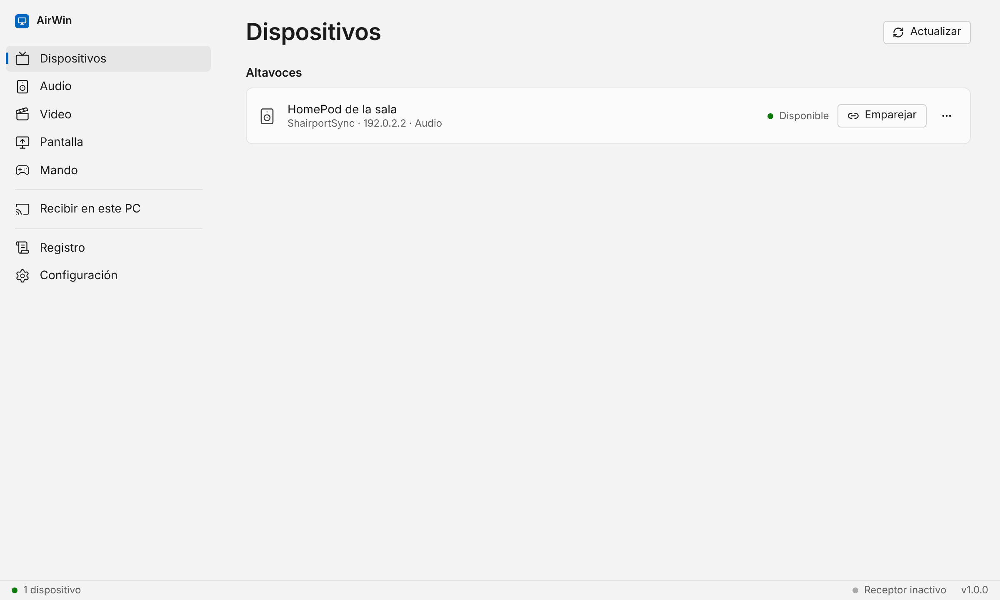
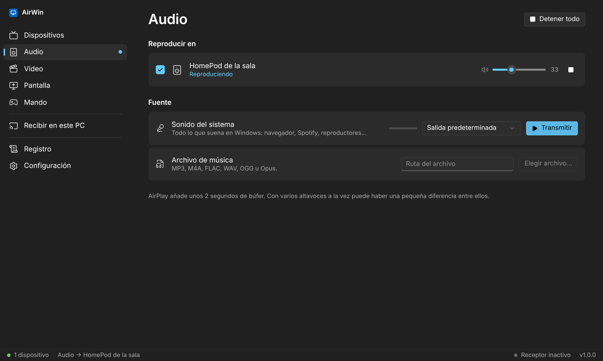
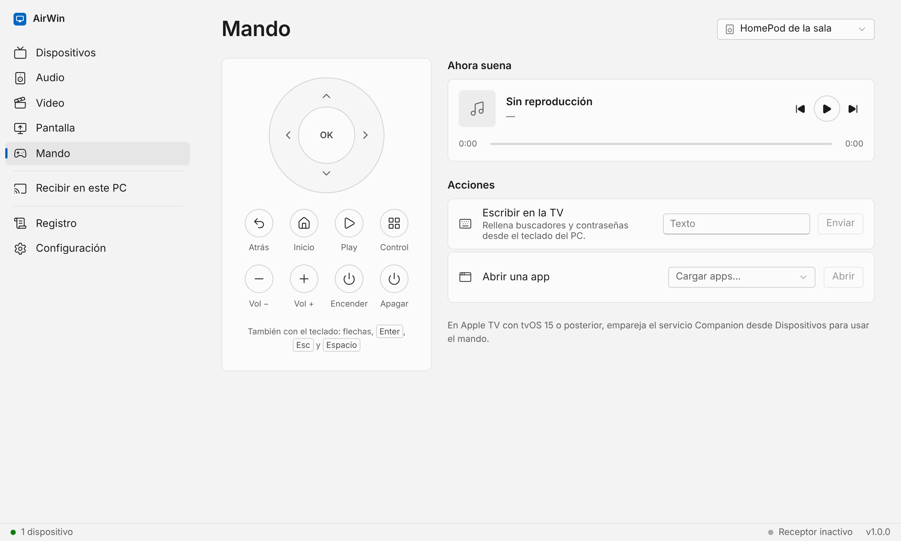
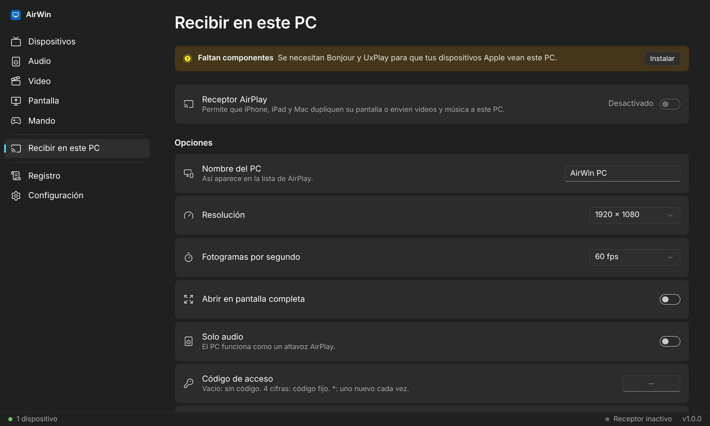

<div align="center">


# AirWin

**AirPlay para Windows: envía, recibe y controla, como si tu PC fuera un Mac más.**

Envía el sonido de Windows a tus HomePod · Manda videos al Apple TV · Duplica tu iPhone en el PC · Usa el PC como mando

[Descargar](https://github.com/emanueldev1/airwin/releases/latest) · [Cómo funciona](#cómo-funciona) · [Compilar](#compilar-desde-el-código) · Licencia MIT



</div>

---

## Qué puede hacer

| | Función | Cómo lo hace |
|---|---|---|
| 🔊 | **Sonido del PC → HomePod / altavoces AirPlay**, uno o varios a la vez | Captura WASAPI *loopback* + AirPlay (RAOP) con [pyatv](https://github.com/postlund/pyatv) |
| 🎵 | **Archivos de música** (MP3, FLAC, M4A, WAV, OGG…) → altavoces | pyatv |
| 🎬 | **Videos y enlaces → Apple TV** a calidad completa (MP4/MOV directos; MKV/AVI/WEBM convertidos al vuelo) | Servidor HTTP local + AirPlay *play URL* (+ FFmpeg → HLS) |
| 🖥️ | **Proyectar el escritorio de Windows en el Apple TV**, con sonido | FFmpeg (gdigrab + NVENC/QSV/AMF/x264) → HLS en vivo |
| 📥 | **Recibir AirPlay**: el PC aparece en «Duplicar pantalla» del iPhone, iPad y Mac, y como altavoz AirPlay | [UxPlay](https://github.com/FDH2/UxPlay) |
| 🎮 | **Mando a distancia** del Apple TV: cruceta, menú, inicio, volumen, encendido, apps, teclado, «Ahora suena» | pyatv (Companion / MRP) |
| 🔗 | **Emparejamiento con PIN** para Apple TV y Mac, como en un Mac (los HomePod no lo necesitan) | pyatv |
| ⬆️ | **Actualizaciones automáticas**: descarga en segundo plano, verificación SHA-256 e instalación con un clic | GitHub Releases + Inno Setup |

### Lo que Apple no permite (y lo que hacemos en su lugar)

La **duplicación de pantalla instantánea del PC al Apple TV** (la de los Mac) va cifrada con FairPlay, y Apple solo la licencia a sus propios equipos. Ningún proyecto libre puede reproducirla. AirWin envía tu escritorio como **video en directo (HLS)**: se ve con mucha calidad, pero con **3–8 segundos de retraso**. Sirve para presentaciones, fotos o vídeos web; no para jugar.

En la otra dirección (**del iPhone/Mac al PC**) la duplicación sí es en tiempo real, gracias a UxPlay.

<table><tr>
<td></td>
<td></td>
</tr><tr>
<td colspan="2"></td>
</tr></table>

## Instalación

1. Descarga `AirWin-Setup-x.y.z.exe` de [Releases](https://github.com/emanueldev1/airwin/releases/latest) e instálalo (o el `.zip` portable si no quieres instalar nada).
   Windows SmartScreen puede avisar porque el instalador no está firmado: pulsa **Más información → Ejecutar de todas formas**.
2. Abre AirWin. Si Windows pregunta por el firewall, permite el acceso en **redes privadas**.
   AirWin se instala solo para tu usuario (en `%LOCALAPPDATA%\Programs\AirWin`) y no pide permisos de administrador.
3. Para **recibir AirPlay** o **proyectar la pantalla**, ve a **Configuración → Componentes** e instala con un clic:
   - **Bonjour** de Apple, para que tu iPhone vea el PC.
   - **UxPlay**, el receptor AirPlay.
   - **FFmpeg**, para proyectar la pantalla y convertir videos.

   (Se instalan con `winget`, incluido en Windows 10 y 11.)

**Requisitos:** Windows 10 (1809+) u 11 de 64 bits, y el PC y los dispositivos Apple en la **misma red**.

### Emparejar un Apple TV

**Dispositivos → Emparejar** y escribe el PIN que aparece en la tele. Empareja **AirPlay** (videos y pantalla) y **Companion** (mando a distancia). Los HomePod y los altavoces no tienen pantalla, así que no se emparejan: AirWin se conecta a ellos directamente.

### Actualizaciones

AirWin busca versiones nuevas al abrirse y cada 6 horas, y las descarga en segundo plano. Cuando una está lista aparece **«Reiniciar y actualizar»**: se instala en silencio y la app vuelve a abrirse. Puedes desactivarlo en **Configuración → Actualizaciones**. La versión portable (`.zip`) avisa de las novedades, pero se actualiza a mano.

> Si instalaste la **1.0.0**, desinstálala antes de instalar la 1.1.0. Esa versión se instalaba en *Archivos de programa* y no incluía el actualizador; desde la 1.1.0 todo es automático.

## Cómo funciona

```
┌───────────────── AirWin.exe ─────────────────┐
│  Ventana nativa (Edge WebView2 vía pywebview)│
│     React + Tailwind + shadcn/ui             │
│              │  HTTP + SSE en 127.0.0.1      │
│              ▼  (token aleatorio por sesión) │
│  Motor en Python (asyncio)                   │
│   ├─ pyatv ─────────── HomePod / Apple TV    │
│   ├─ soundcard (WASAPI loopback)             │
│   ├─ servidor multimedia (aiohttp, HLS)      │
│   ├─ FFmpeg ─────────── pantalla → HLS       │
│   └─ UxPlay ─────────── receptor AirPlay     │
└──────────────────────────────────────────────┘
```

- `airwin/core/live_audio.py` incluye una fuente PCM en vivo que pyatv acepta directamente, con un búfer anti-retraso y relleno de silencio, así la transmisión nunca se corta aunque no suene nada.
- `airwin/server.py` es la API local. Solo escucha en `127.0.0.1` y exige un token, así que ninguna web abierta en tu navegador puede controlar tus dispositivos.
- `frontend/` contiene la interfaz: componentes [shadcn/ui](https://ui.shadcn.com) sobre Radix con el lenguaje visual de Windows 11 (Fluent), en tema claro y oscuro.

## Compilar desde el código

Necesitas **Python 3.11+** y **Node 20+**.

```powershell
git clone https://github.com/emanueldev1/airwin
cd airwin
powershell -ExecutionPolicy Bypass -File scripts\build.ps1
```

Así obtienes `dist\AirWin\AirWin.exe`, y también el instalador si tienes [Inno Setup 6](https://jrsoftware.org/isinfo.php).

### Publicar una versión nueva

Las releases son automáticas. GitHub Actions compila AirWin en cada *push* a `main`. Si la versión todavía no está publicada, crea la etiqueta `vX.Y.Z` y una release con el instalador y el `.zip` portable.

Para sacar una versión nueva:

1. Cambia `__version__` en `airwin/__init__.py` (por ejemplo, de `1.0.0` a `1.1.0`).
2. Haz commit y push a `main`.

Las notas de la release se generan solas a partir de los commits y *pull requests*. Las copias instaladas de AirWin detectan la versión nueva y se actualizan solas. El workflow publica también un `SHA256SUMS.txt`, que el actualizador usa para verificar la descarga.

**Desarrollo con recarga en caliente:** `scripts\dev.ps1` (o `scripts/dev.sh`) arranca el motor y Vite. Abre <http://localhost:5173>.

Sin compilar: `pip install -r requirements.txt`, `cd frontend && npm i && npm run build`, `python -m airwin`.

## Preguntas frecuentes

**No aparece ningún dispositivo.** Comprueba que estéis en la misma red y que no sea una red de invitados o con «aislamiento de clientes». Revisa que el firewall permita AirWin en redes privadas.

**El iPhone no ve el PC.** Instala Bonjour desde Configuración, activa el receptor y permite `uxplay.exe` en el firewall.

**Hay retraso en el sonido.** AirPlay tiene siempre unos 2 s de búfer; así funciona el protocolo (también en el Mac).

**¿Es legal?** Sí. Usa protocolos documentados por la comunidad mediante ingeniería inversa para interoperabilidad, igual que pyatv, UxPlay o shairport-sync. AirWin no está afiliado a Apple; AirPlay, HomePod y Apple TV son marcas de Apple Inc.

## Contribuir

¡Las *pull requests* son bienvenidas! Ideas pendientes:

- [ ] Sincronización precisa multiroom (AirPlay 2 con PTP)
- [ ] Icono en la bandeja del sistema y arranque con Windows
- [ ] Firmar el instalador (evita el aviso de SmartScreen)
- [ ] Traducción al inglés
- [ ] Recibir audio con metadatos (carátula y título) en la interfaz

## Créditos

[pyatv](https://github.com/postlund/pyatv) (MIT) · [UxPlay](https://github.com/FDH2/UxPlay) (GPL-3.0, se instala aparte) · [uxplay-windows](https://github.com/leapbtw/uxplay-windows) · [FFmpeg](https://ffmpeg.org) · [pywebview](https://pywebview.flowrl.com) · [shadcn/ui](https://ui.shadcn.com) · [soundcard](https://github.com/bastibe/SoundCard)

Licencia [MIT](LICENSE).
